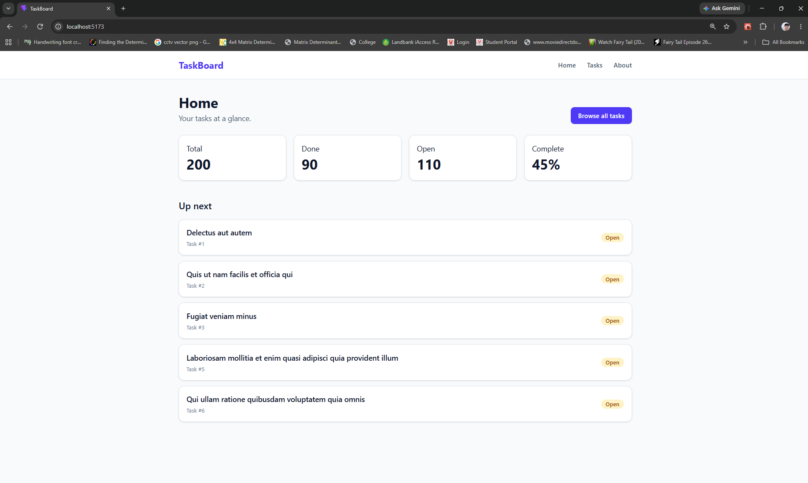
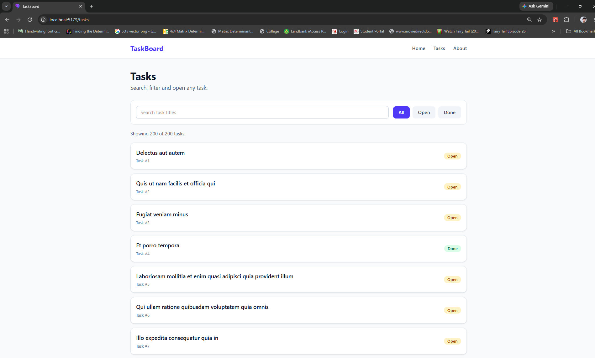
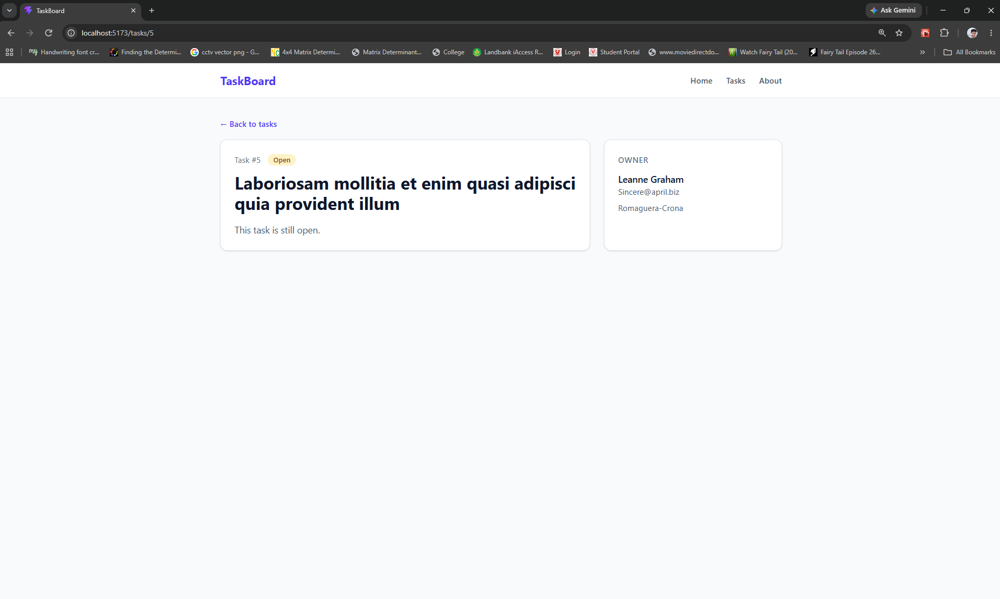
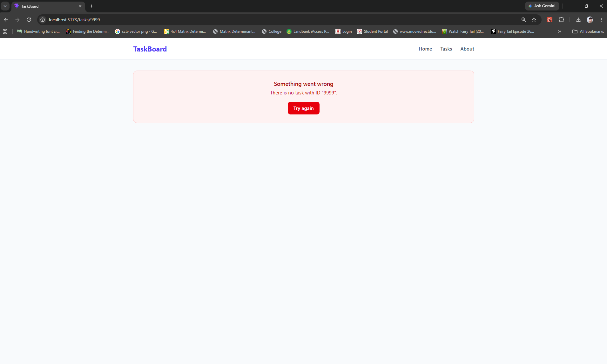
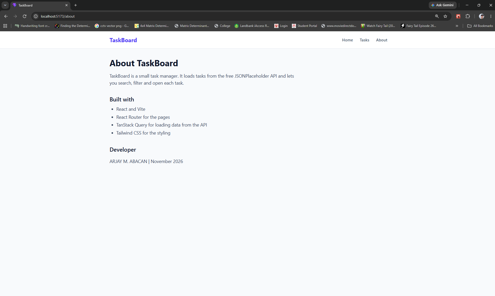
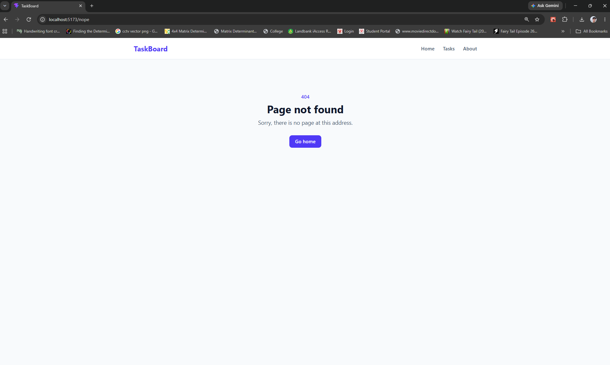
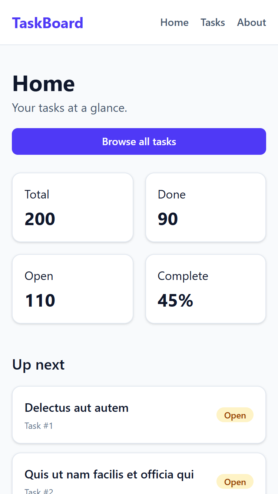
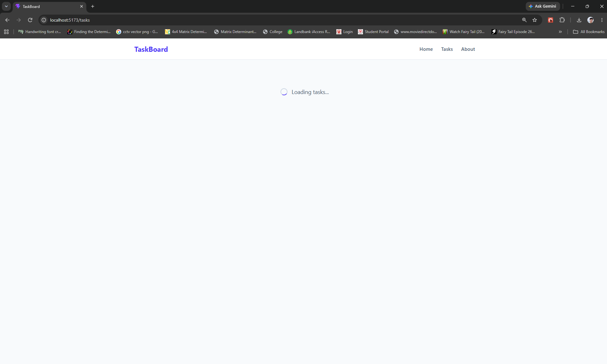
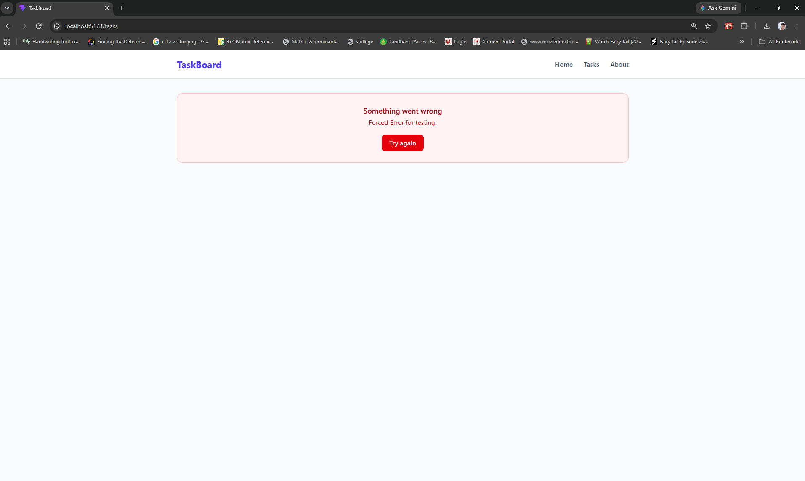
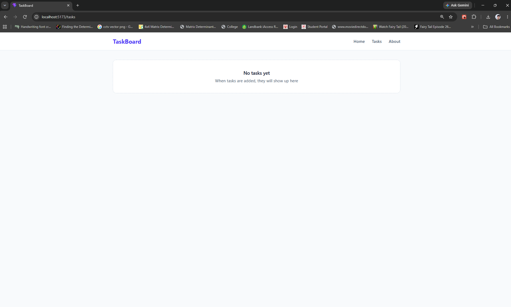

# TaskBoard

TaskBoard is a multi-page task and productivity manager built with React. It loads 200 tasks from a public API with TanStack Query, lets you search and filter them, and shows the details and owner of each task. The interface is built with Tailwind CSS and works on phones and desktops.

Built by Arjay Abacan for Mini Project 1: React Task & Productivity Manager.

## Features

### Routes

| Route        | Page           | What it shows                                                                             |
| ------------ | -------------- | ----------------------------------------------------------------------------------------- |
| `/`          | Home           | A summary of all tasks: total, done, open, percent complete and the next five open tasks. |
| `/tasks`     | Tasks          | Every task, with a search box and All, Open and Done filters.                             |
| `/tasks/:id` | Task detail    | One task, read from the `:id` in the URL, plus the person who owns it.                    |
| `/about`     | About          | What the app is, what it was built with, and who built it.                                |
| `*`          | Page not found | Any other address shows a 404 page with a link home.                                      |

### Public API

The app uses [JSONPlaceholder](https://jsonplaceholder.typicode.com), a free API that needs no key.

| Request          | Used for                                      |
| ---------------- | --------------------------------------------- |
| `GET /todos`     | The Home and Tasks pages (200 tasks).         |
| `GET /todos/:id` | The task detail page. Unknown IDs return 404. |
| `GET /users/:id` | The owner card on the task detail page.       |

All three requests are in `src/api.js`.

### How TanStack Query is used

All data is loaded with `useQuery`. There is no `useEffect` fetching and no hand-made loading state.

| Query key          | Where it is used        | Why this key                                                                                              |
| ------------------ | ----------------------- | --------------------------------------------------------------------------------------------------------- |
| `['tasks']`        | `HomePage`, `TasksPage` | Both pages use the same key, so they share one cached list. Moving between them shows the data instantly. |
| `['task', id]`     | `TaskDetailPage`        | The `id` from the URL is part of the key, so every task has its own cache entry.                          |
| `['user', userId]` | `OwnerInfo`             | Each owner is cached separately, so opening another task by the same person reuses it.                    |

The `QueryClient` in `src/main.jsx` sets `retry: 1`, so a failed request is tried once more before the error is shown.

### Loading, error and empty states

Each state comes from the values that `useQuery` returns: `isLoading`, `isError`, `error` and `data`. The three message components, `LoadingMessage`, `ErrorMessage` and `EmptyMessage`, are shared by every page that loads data.

| State   | What you see                                                                                                                        | How to see it                                                                                         |
| ------- | ----------------------------------------------------------------------------------------------------------------------------------- | ----------------------------------------------------------------------------------------------------- |
| Loading | A spinner with "Loading tasks..." while the request is in flight ("Loading your summary..." on Home, "Loading task..." on a task). | In `src/api.js`, set `FORCE` to `'slow'`. Or in browser DevTools, open **Network** and choose **3G**. |
| Error   | A red "Something went wrong" box with the reason and a **Try again** button, which runs the request again.                        | Open `/tasks/9999` or `/tasks/abc`. Or set `FORCE` to `'error'`.                                      |
| Empty   | "No tasks yet" when the API returns no tasks, and "No matching tasks" when a search or filter finds nothing.                       | Set `FORCE` to `'empty'`. Or on `/tasks`, search for `weekly report`.                                 |

`FORCE` is a test switch at the top of `src/api.js`. It is `null` in normal use.

### Components

Each component has one job. Data goes down as props, and events come back up through callback props.

| Component                                        | Props                                                  | Job                                                        |
| ------------------------------------------------ | ------------------------------------------------------ | ---------------------------------------------------------- |
| `NavBar`                                         | none                                                   | The links to Home, Tasks and About, on every page.         |
| `TaskFilters`                                    | `search`, `status`, `onSearchChange`, `onStatusChange` | The search box and the All, Open and Done buttons.         |
| `TaskList`                                       | `tasks`                                                | Turns an array of tasks into a list of cards.              |
| `TaskCard`                                       | `task`                                                 | One task as a card that links to `/tasks/:id`.             |
| `StatusBadge`                                    | `completed`                                            | The green **Done** or amber **Open** badge.                |
| `StatCard`                                       | `label`, `value`                                       | One number in the Home page summary.                       |
| `OwnerInfo`                                      | `userId`                                               | Loads and shows the task owner's name, email and company.  |
| `LoadingMessage`, `ErrorMessage`, `EmptyMessage` | `text`; `message`, `onRetry`; `title`, `message`       | The loading, error and empty states, reused on every page. |

`TaskList`, `TaskCard` and `StatusBadge` are reused on both the Home and Tasks pages, and `StatusBadge` is reused again on the task detail page.

### State ownership

- **`TasksPage` owns `search` and `status` with `useState`.** It is the nearest parent of both things that use them: the filter bar that changes them and the list that is filtered by them.
- **`TaskFilters` holds no state of its own.** It gets the current values as props and reports changes through the `onSearchChange` and `onStatusChange` callbacks.
- **Derived values are calculated, not stored.** The filtered list, "Showing 35 of 200 tasks" and the Home page numbers are all worked out from the data on each render.
- **Server data lives in TanStack Query, not in `useState`.**

### Responsive design and accessibility

The layout is mobile-first: it is built for phones, and Tailwind's `sm:` and `md:` prefixes add the wider layouts.

- **Home:** the stat cards are in 2 columns on phones and 4 from 768px wide (`grid-cols-2 md:grid-cols-4`).
- **Tasks:** the search box sits above the filter buttons on phones and beside them from 640px wide (`flex-col sm:flex-row`).
- **Task detail:** the owner card sits under the task on phones and beside it from 768px wide (`md:grid-cols-3`).

Accessibility basics:

- The search box has a label for screen readers (`sr-only`), and a focus ring when you click or tab into it.
- The filter buttons are grouped with `role="group"` and an `aria-label`, and `aria-pressed` says which one is selected.
- The loading message uses `role="status"` and the error message uses `role="alert"`, so screen readers announce them.
- The pages use `<header>`, `<nav>`, `<main>`, `<article>` and `<aside>`, and every link is a real link you can reach with the keyboard.

### Screenshots

#### Home (`/`)



#### Tasks (`/tasks`)



#### Task detail (`/tasks/:id`)



#### Task detail with an unknown ID (`/tasks/9999`)



#### About (`/about`)



#### Page not found (`*`: any other address, such as `/nope`)



#### Mobile



#### Loading, error and empty

| Loading                                                     | Error                                              | Empty                                             |
| ----------------------------------------------------------- | -------------------------------------------------- | ------------------------------------------------- |
|  |  |  |

## Setup

You need [Node.js](https://nodejs.org) 20.19 or newer, or 22.12 or newer. The project was built and tested with Node.js 24.

```bash
git clone https://github.com/arjay-abacan/taskboard.git
cd taskboard
npm install
npm run dev
```

Then open <http://localhost:5173>. No API key or `.env` file is needed.

| Command           | What it does                                |
| ----------------- | ------------------------------------------- |
| `npm run dev`     | Starts the app with live reload.            |
| `npm run lint`    | Checks the code with ESLint.                |
| `npm run build`   | Builds the production version into `dist/`. |
| `npm run preview` | Serves the production build to test it.     |

## Tech stack

- React 19 and Vite 8
- React Router 7 (`react-router-dom`)
- TanStack Query 5
- Tailwind CSS 4
- ESLint 10

## Live demo (stretch)

Not deployed. The project includes `vercel.json`, so it can be deployed to Vercel with the default Vite settings.
